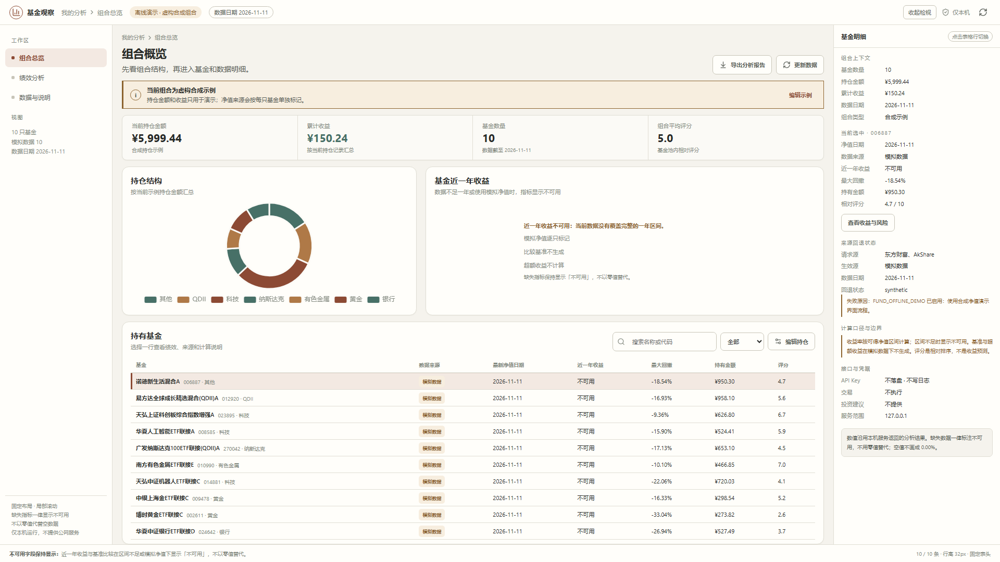
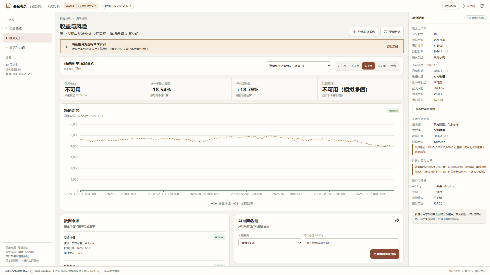
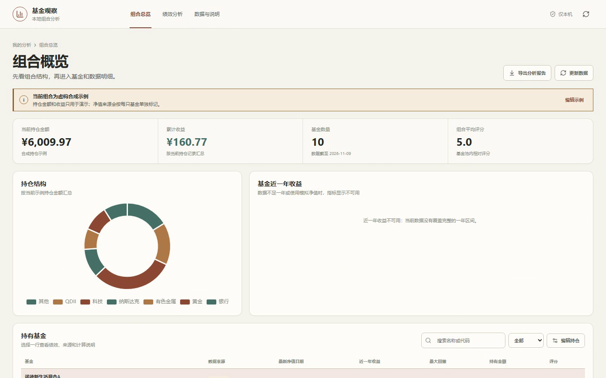
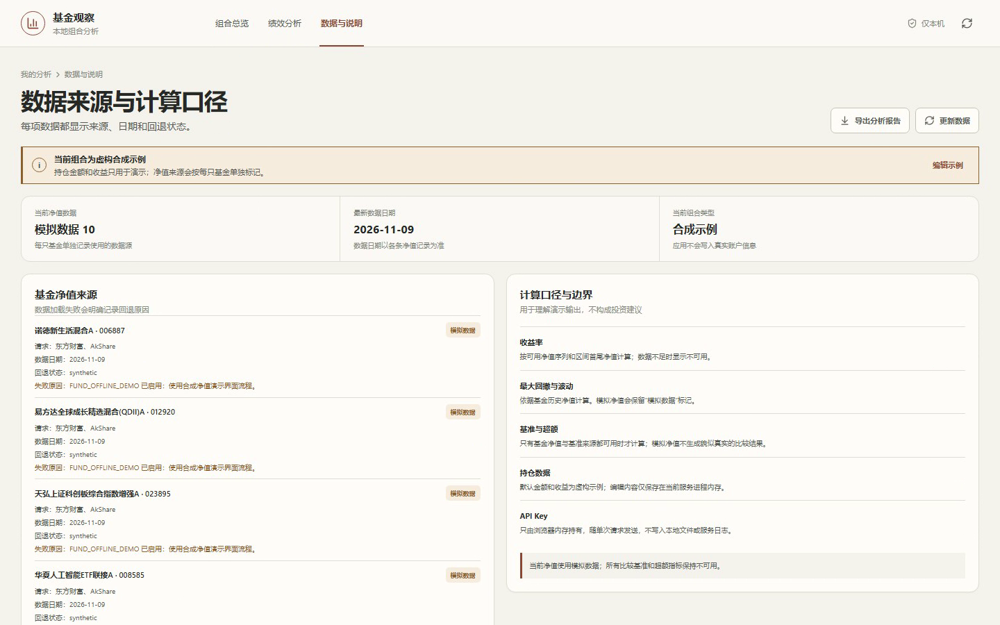
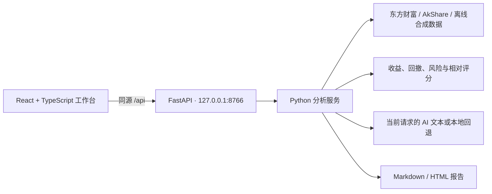

# AI 智选基金助手

**v0.3.0 · React + TypeScript · FastAPI · Python 3.12 · Node.js 24 · 本地单用户**

在线作品集展示页（无需安装即可查看两个项目的真实截图、验收证据与能力边界）：https://mahonghao1.github.io/Embodied-AI-Data-Processing-Platform/

把组合表现、风险指标、基金明细和数据来源放进一套本地分析工作台。Python 继续负责净值处理、指标计算与 AI 回退；浏览器只呈现本机 API 返回的分析结果。


> 截图于 2026-11-09 从 FastAPI 本地服务生成。持仓是虚构合成样例，净值标为模拟数据；由于区间不足一年，近一年收益明确显示为不可用，基准比较也不可用。截图仅展示界面和数据来源呈现。

[观看 7 秒工作台交互演示（WebM）](docs/screenshots/demo-v0.2.0.webm) · 使用离线合成数据，无真实账户或投资数据。

## v0.3.0 · 16:9 固定工作台

界面从「窄栏长页」重做为**一屏闭环的固定工作台**：顶栏 48px、侧栏 216px、主区自适应、检视面板 320px、底部口径状态条 34px。整页不再滚动，只有主区与检视面板局部滚动；在 1920×1080 下 KPI、四张卡片、10 行持仓表与右侧检视全部同屏可见。



> 2026-11-11 从本机 FastAPI 离线演示服务（同源托管构建后的 `frontend/dist`）生成。近一年收益与基准比较明确显示「不可用」，不以 0.00% 代替；右侧检视列出净值来源、回退状态与计算口径。



> 绩效与风险视图，已等待净值曲线加载完成后截取，不含「正在加载」占位。图表数据来自演示用合成净值序列，界面保留来源与模拟标记。

| 改动 | 效果 |
| --- | --- |
| 统一 Shell | 导航从顶栏迁入侧栏；顶栏只放品牌、面包屑、状态与检视开关 |
| 全宽表格 | 32px 行高 + 固定表头，10 行全部进入 1920×1080 首屏，不再被状态条遮挡 |
| 行检视联动 | 点任意一行即更新右侧检视，不跳页；搜索后按原始行索引回填，检视内容不会串位 |
| 不可用状态 | 收益不可用时给出带原因的说明块，不隐藏列、不伪装成零收益 |
| 主动留白处理 | 收紧卡片与图表高度，把表格下方的空白换成有语义的不可用说明，而非让表格被折叠线截断 |

**边界**：本次是纯前端布局重构，API 契约、Python 分析逻辑、数据口径与验收范围均未改变；服务仍只监听 `127.0.0.1`，不提供公网交互实例。面板拖拽与布局保存未实现。

## 界面一览

历史与当前视角分别回答「组合长什么样」「图表加载完成后是什么状态」「数据究竟从哪来」「16:9 新工作台是什么样」。全部为本机实际运行截图，取自离线合成演示模式，未补画、未修饰。v0.3.0 的新界面截图见上一节。



> 组合总览加载完成状态。顶部橙色横幅始终标注「当前组合为虚构合成示例」；近一年收益与基准比较明确显示不可用，空值不会被画成 0.00%。



> 数据来源与计算口径页。每只基金分别标出净值来源（东方财富 / AkShare / 模拟数据）、数据日期与回退状态；右侧同时列出计算口径与能力边界。

| 视角 | 查看 | 说明 |
| --- | --- | --- |
| **v0.3.0 组合总览（16:9）** | [截图](docs/screenshots/app_v0.3.0.png) | 固定 Shell、全宽 10 行表格、右侧检视与底部口径状态条 |
| **v0.3.0 绩效与风险（16:9）** | [截图](docs/screenshots/app_v0.3.0-analysis.png) | 净值走势加载完成态、数据来源、AI 辅助说明与右侧检视 |
| 组合总览（v0.2.x，含空状态） | [截图](docs/screenshots/app_v0.2.0.png) | 合成组合提示、四项指标、不可用的近一年收益 |
| 组合总览加载完成态 | [截图](docs/screenshots/fund-overview-v0.2.0.png) | 持仓结构环形图与分类图例 |
| 数据来源与计算口径 | [截图](docs/screenshots/fund-provenance-v0.2.0.png) | 逐只基金的净值来源、日期与回退状态 |
| 7 秒界面演示（v0.2.x） | [WebM 视频](docs/screenshots/demo-v0.2.0.webm) | 指标卡、图表与视图切换的交互过程 |
| 旧版界面（历史 v0.1.0） | [截图](docs/screenshots/app_v0.1.0.png) | 早期界面，仅作迭代对照 |

> v0.2.x 的截图与 7 秒演示对应旧的长页布局，保留作迭代对照；当前界面以 v0.3.0 两张 1920×1080 截图为准。

## 为什么单独做这个项目

验证「把数据来源写进界面」这件事。真实净值、AkShare 回退、模拟净值、离线演示四条路径都在页面和报告里留痕；当区间不足一年、基准不可比或数据源失败时，界面说「不可用」，而不是给出一个好看但无依据的数字。Python 负责净值标准化、风险计算与报告生成，浏览器只呈现本机 API 的返回结果。

## 能力与验证

- **组合总览**：持仓金额、累计收益、基金数量、组合评分、结构图和可筛选持仓表。
- **绩效与风险**：收益、回撤、波动率和净值历史；缺失或样本不足的指标显示不可用，不用零值代替。
- **来源说明**：基金净值和基准分别记录来源、数据日期、回退状态与失败原因，并显示在页面和 Markdown / HTML 报告中。
- **Python 核心**：继续复用既有数据加载、净值标准化、风险计算、相对评分和 AI 文本生成逻辑。
- **本地 AI 回退**：无密钥时使用本地规则并显示模式与免责声明；有密钥时只随当前建议请求传递，不落盘、不写日志。
- **验证证据**：测试覆盖公开数据源响应和异常、无效净值、回退、收益与回撤、离线不联网、报告标识和 API 行为；前端包含单测与浏览器流程测试。

默认持仓是合成数据，不连接真实账户、不提交交易，也不提供投资建议。离线模拟净值只用于演示产品流程；任何图表、评分、收益数字或 AI 文本都不能视为投资结论。

## 本地启动

需要 Windows、Python 3.12、Node.js 24 LTS 和 [uv](https://docs.astral.sh/uv/getting-started/installation/)。克隆仓库后，在 PowerShell 执行：

```powershell
git clone https://github.com/MAHONGHAO1/AI-Fund-Management-Platform.git
cd AI-Fund-Management-Platform
py -3.12 -m pip install uv
uv sync --locked
Push-Location frontend
npm ci
npm run build
Pop-Location
$env:FUND_OFFLINE_DEMO = "true"
uv run --locked python -m fund_web
```

服务只监听本机。默认使用离线演示数据，确保合成持仓、模拟净值和不可用基准的展示可重复；启动后在浏览器打开 [http://127.0.0.1:8766](http://127.0.0.1:8766)。也可在安装好 Node.js 24 LTS 与 uv 后双击 `启动基金助手.cmd`；启动脚本会用 `npm ci` 安装锁定前端依赖、构建页面并启动 FastAPI。它不会自动打开浏览器。

如需开发热更新，可在一个终端运行 `uv run --locked python -m fund_web`，再在另一个终端运行：

```powershell
cd frontend
npm ci
npm run dev
```

Vite 开发页面地址为 `http://127.0.0.1:5173`，API 请求转发到本机 8766 端口。

### 离线作品演示

离线模式下，应用不请求公开净值数据源，页面会分别标记合成持仓和模拟净值；无 API Key 时继续使用本地建议回退。启动脚本默认打开该模式；手工启动后端时也应设置：

```powershell
$env:FUND_OFFLINE_DEMO = "true"
.\启动基金助手.cmd
```

若要检查公开数据源及其回退流程，把变量设为 `false` 后再启动。该设置只影响当前终端启动的进程。

## 测试与锁定依赖

使用与 GitHub Actions 相同的 Python 3.12、Node.js 24 和锁定文件：

```powershell
uv sync --locked
uv run --locked python -m pytest -q
Push-Location frontend
npm ci
npm test
npx playwright install chromium
npm run test:e2e
npm run build
Pop-Location
```

本机验收环境为 Python 3.12.10 / Node.js 24.15.0；Python 测试 19 项通过，前端单测与浏览器关键流程通过，`npm ci` 安全审计为 0 项漏洞。CI 使用合成响应，不依赖外网基金数据。

## 架构



## 文档与发布状态

- [v0.3.0 发布说明](RELEASE_NOTES_v0.3.0.md)
- [数据来源与计算状态](docs/STATUS_v0.2.0.md)
- [v0.2.1 发布说明](RELEASE_NOTES_v0.2.1.md)
- [v0.2.0 发布说明](RELEASE_NOTES_v0.2.0.md)
- [变更记录](CHANGELOG.md)

v0.2.0 已合并到 `main` 并发布为 [GitHub Release](https://github.com/MAHONGHAO1/AI-Fund-Management-Platform/releases/tag/v0.2.0)；v0.2.1 在功能代码不变的前提下补齐界面截图、图集与介绍，发布为 [v0.2.1 Release](https://github.com/MAHONGHAO1/AI-Fund-Management-Platform/releases/tag/v0.2.1)。v0.3.0 是纯前端布局重构版本，发布为 [v0.3.0 Release](https://github.com/MAHONGHAO1/AI-Fund-Management-Platform/releases/tag/v0.3.0)。两个项目的在线展示见[作品集展示页](https://mahonghao1.github.io/Embodied-AI-Data-Processing-Platform/)。

## English

A local portfolio analytics demo with a React and TypeScript frontend, a loopback-only FastAPI bridge, and Python analysis logic. It records NAV and benchmark provenance, labels synthetic holdings and simulated NAV, and keeps benchmark comparisons unavailable when the data does not support them. No account connection, trading, or investment advice is provided. v0.2.1 adds verified UI screenshots and a fuller walkthrough without changing the application code. v0.3.0 rebuilds the UI as a fixed 16:9 workbench (48px header, 216px sidebar, fluid main area, 320px inspector, 34px status bar) with a full-width 32px table and row-linked inspection; API contracts, Python analytics, data provenance and the validated scope are unchanged.
