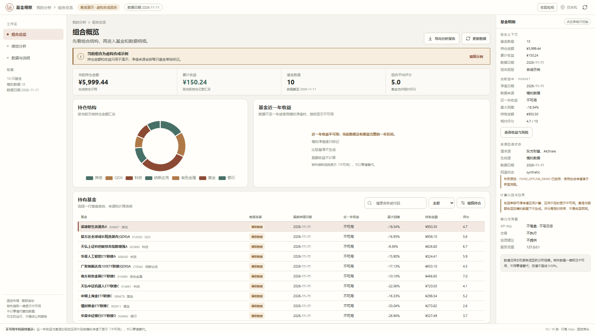
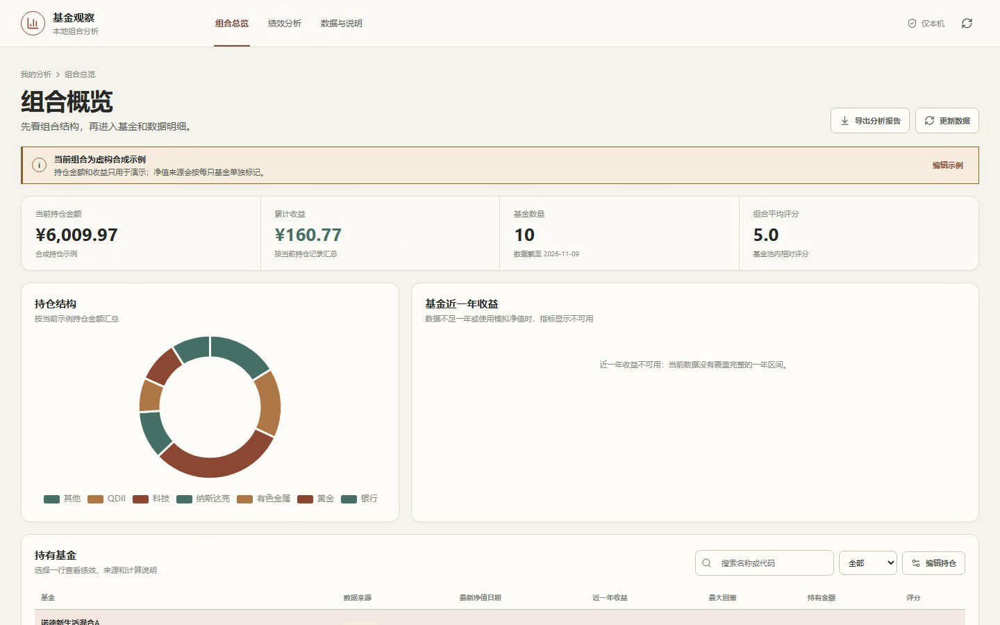
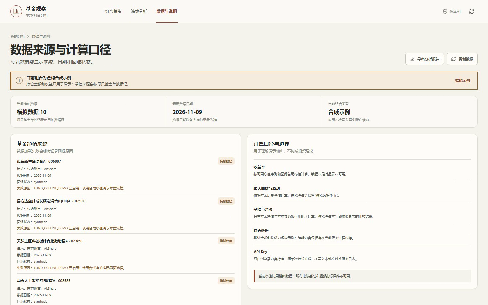
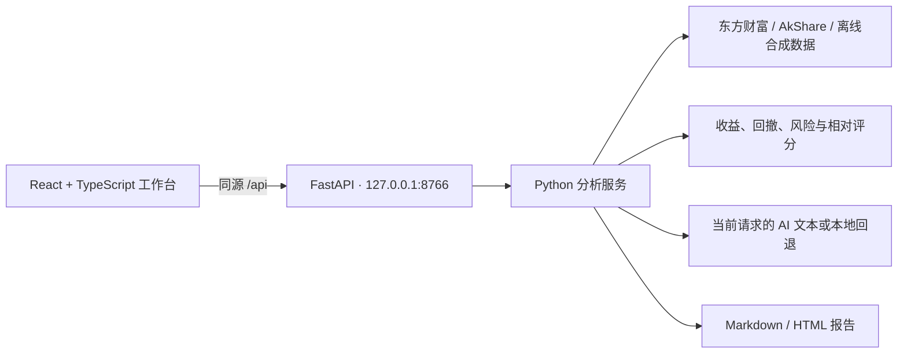
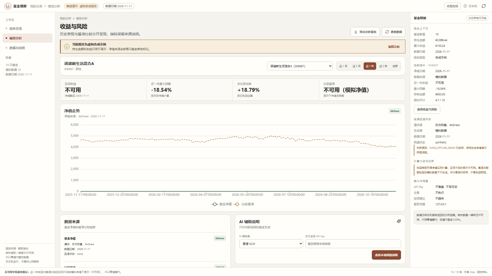

# 基金观察 · Fund Lens

**先说清每个数字从哪来，再谈收益。**

v0.5.0 · React + TypeScript · FastAPI · Python 3.12 · Node.js 24 · 本地单用户

[](https://github.com/MAHONGHAO1/AI-Fund-Management-Platform/actions/workflows/tests.yml) [](https://github.com/MAHONGHAO1/AI-Fund-Management-Platform/releases/tag/v0.5.0) [](LICENSE) [](https://mahonghao1.github.io/)

基金 App 上那个「近一年收益 12.4%」，你信吗？它可能是三年前某天的净值算出来的，也可能中途中止过计算，只是没告诉你。

这个工作台换个顺序：**先回答这个数能不能用，再把这个数给你**。每只基金的净值来源、取数日期、回退原因都逐条摊开；数据撑不起这个区间，就写「不可用」，不拿 0.00% 糊过去。

> **60 秒证据**：版本链（README / `pyproject.toml` / API / 前端）由测试锁定；后端、前端单测与浏览器流程均通过；离线模式不发起外网请求。复现命令、测试数量、环境与截图来源统一放在 [docs/EVIDENCE.md](docs/EVIDENCE.md)。AI 只解释已算好的指标，不选基、不改评分；边界与评测见 [docs/AI_LAYER.md](docs/AI_LAYER.md)。



> 本机 FastAPI 离线演示服务截取。持仓是虚构合成样例，净值标为模拟数据。模拟净值一律不算收益与风险指标，所以这里显示「不可用」——这是规则，不是碰巧数据不够长。

## 三个你可能正在经历的场面

**同一只基金，三个 App 三个收益率。** 谁也不说自己是按哪段区间、哪天净值算的。这里把区间写在按钮上，把区间首尾日期写在数字下面，把数据源写在同一张卡里。对不上时，你知道该去质疑谁。

**数据源挂了，页面还在展示收益。** 很多工具会悄悄切到备用源、或者干脆沿用上一次的值，数字照旧好看。这里回退是要留痕的：请求了哪个源、实际用了哪个、为什么回退、失败原因是什么，全在「数据来源」页。

**指标算不出来，却显示成 0.00%。** 一只成立不到一年的基金没有「近一年收益」，这是事实，不是缺陷。工作台让它显示「不可用」，并说明原因，而不是填一个零让你误读成「没涨没跌」。

## 它替你省掉什么

| 通常的做法 | 这里 |
| --- | --- |
| 只看一个收益率数字就下判断 | 数字旁边永远带着来源、日期、区间和可用性 |
| 数据源失败时页面照常显示旧值 | 回退逐条留痕，模拟数据逐只标记 |
| 导出报告只有结论 | Markdown / HTML 报告带完整来源与边界说明 |
| 想知道口径得翻代码 | 「数据与说明」页直接列出计算口径 |

## 现在能看到什么



> 顶部横幅常驻标注「当前组合为虚构合成示例」。空值不会被画成 0.00%。



> 每只基金分别标出净值来源（东方财富 / AkShare / 模拟数据）、数据日期与回退状态；右侧同时列出计算口径与能力边界。

| 视角 | 查看 | 说明 |
| --- | --- | --- |
| 组合总览（16:9） | [截图](docs/screenshots/app_v0.3.0.png) | 固定 Shell、全宽 10 行表格、右侧检视与底部口径状态条 |
| 绩效与风险（16:9） | [截图](docs/screenshots/app_v0.3.0-analysis.png) | 净值走势加载完成态、数据来源、AI 辅助说明与右侧检视 |
| 加载完成态 | [截图](docs/screenshots/fund-overview-v0.2.0.png) | 持仓结构环形图与分类图例 |
| 数据来源与口径 | [截图](docs/screenshots/fund-provenance-v0.2.0.png) | 逐只基金的净值来源、日期与回退状态 |
| 7 秒界面演示 | [WebM](docs/screenshots/demo-v0.2.0.webm) | 指标卡、图表与视图切换（v0.2.x 旧布局） |

v0.2.x 的截图与录像对应旧的长页布局，留作迭代对照；当前界面看 v0.3.0 两张 1920×1080。

## 为什么单独做这个

市面上的基金工具，多数把「算得准」当成卖点。但真到你手上，判断能不能用的信息往往被折叠进一个二级页面，甚至根本没有。

这个项目想验的是另一件事：**把数据来源写进界面，产品会不会更好用**。真实净值、AkShare 回退、模拟净值、离线演示四条路径，都在页面和报告里留了痕。区间不够、基准不可比、数据源失败，界面就说「不可用」。Python 负责净值标准化、风险计算和报告生成，浏览器只呈现本机 API 的返回结果。

## 能力与验证

- **组合总览**：持仓金额、累计收益、基金数量、组合评分、结构图和可筛选持仓表。
- **绩效与风险**：收益、回撤、波动率和净值历史；缺失或样本不足的指标显示不可用，不用零值代替。
- **来源说明**：基金净值和基准分别记录来源、数据日期、回退状态与失败原因，页面与 Markdown / HTML 报告同步呈现。
- **数据源健康**：每次取数尝试都留痕。「数据与说明」页按来源累计成功 / 失败次数、连续失败数和最近成功时间，连续失败两次标为降级并写出原因；没有记录时显示空状态，不把空表当「全部正常」。
- **Python 核心**：数据加载、净值标准化、风险计算与相对评分；AI 只写解释文本，不参与筛选、评分或指标计算。
- **可选 AI 文本层**：无密钥、调用失败或输出越界时走本地模板并显示模式；有密钥时只随当前请求传递，不落盘、不写日志。输出不得出现交易指令词，引用数值必须与表格一致，否则整段回退。见 [AI 层边界与离线评测](docs/AI_LAYER.md)。
- **验证**：后端、前端单测与浏览器流程均通过；覆盖公开数据源响应与异常、无效净值、回退、收益与回撤口径、离线不联网、报告标识、AI 边界与 API 行为。测试数量与原始汇总见 [docs/EVIDENCE.md](docs/EVIDENCE.md)。

默认持仓是合成数据，不连接真实账户、不提交交易、不提供投资建议。离线模拟净值只用于演示产品流程，任何图表、评分、收益数字或 AI 文本都不构成投资结论。

## 本地启动

Windows、Python 3.12、Node.js 24 LTS 和 [uv](https://docs.astral.sh/uv/getting-started/installation/)。克隆后在 PowerShell 执行：

```powershell
git clone https://github.com/MAHONGHAO1/AI-Fund-Management-Platform.git
cd AI-Fund-Management-Platform
py -3.12 -m pip install uv
uv sync --locked
Push-Location frontend
npm ci
npm run build
Pop-Location
$env:FUND_OFFLINE_DEMO = "true"
uv run --locked python -m fund_web
```

服务只监听本机，默认使用离线演示数据，保证合成持仓、模拟净值和不可用基准的展示可重复。启动后打开 [http://127.0.0.1:8766](http://127.0.0.1:8766)。装好 Node.js 24 与 uv 后，也可以直接双击 `启动基金助手.cmd`，脚本会用 `npm ci` 装锁版前端依赖、构建页面并启动服务（不会自动开浏览器）。

开发热更新：一个终端跑 `uv run --locked python -m fund_web`，另一个终端：

```powershell
cd frontend
npm ci
npm run dev
```

Vite 页面在 `http://127.0.0.1:5173`，API 转发到本机 8766。

### 离线作品演示

离线模式下应用不请求公开净值数据源，页面分别标记合成持仓和模拟净值；无 API Key 时继续用本地建议回退。启动脚本默认打开该模式，手工启动后端时也应设置：

```powershell
$env:FUND_OFFLINE_DEMO = "true"
.\启动基金助手.cmd
```

想检查公开数据源及其回退流程，把变量设为 `false` 再启动。该设置只影响当前终端启动的进程。

## 测试与锁定依赖

与 GitHub Actions 使用同一套 Python 3.12、Node.js 24 和锁定文件：

```powershell
uv sync --locked
uv run --locked python -m pytest -q
Push-Location frontend
npm ci
npm test
npx playwright install chromium
npm run test:e2e
npm run build
Pop-Location
```

本机验收环境为 Python 3.12.10 / Node.js 24；Python 测试、前端单测与浏览器关键流程均通过。逐项环境、数量与原始汇总见 [docs/EVIDENCE.md](docs/EVIDENCE.md)。测试建议带 `--basetemp`，避免本机累积的 pytest 临时目录触发清理保护：

```powershell
uv run --locked python -m pytest tests/ -q --basetemp=/tmp/fund-pytest
```

CI 使用合成响应，不依赖外网基金数据。

## 架构



## 版本记录

每一版改了什么、为什么改，都写在这里。想看当前能力，往上翻到「能力与验证」。

## v0.4.0 · 指标口径与模拟数据边界修正

**这一版没有新功能。** 修的是「界面上的数字和它的标签对不上」这类问题——一个收益率写错区间、一个回撤漏算前期高点，比少一个功能严重得多。

| 修掉的问题 | 之前的表现 | 现在 |
| --- | --- | --- |
| 区间收益口径 | 点「近 1 月 / 近 3 年」只改标题，数值恒为近一年 | 按所选区间用净值首尾计算；数据不够长时明说「数据源仅覆盖 N 天」 |
| 最大回撤峰值 | 峰值只在窗口内取，窗口外的高点被漏掉，-50% 可能显示 0.00% | 峰值取全历史 `cummax` 再算窗口内回撤 |
| 模拟净值推算持仓 | 数据源失败时用合成净值改写你录入的持仓金额 | 保留你录入的快照金额，模拟净值不推算 |
| 前端自算模拟收益 | 「最大回撤：不可用」旁边同时显示「区间收益：+21.30%」 | 可用性由后端契约裁决（`synthetic` / `metrics_available`），四张卡统一门禁 |
| 「全部」区间语义 | 用 3650 天顶替，成立不足 10 年的基金全部误报「数据不完整」 | 区分「你选的区间没取满（`truncated`）」与「顶到 10 年上限（`history_capped`）」 |
| 报告里的 `nan` | HTML 报告表格与 AI 提示词直接印出字面量 `nan` | 统一 `fmt_score()` 出口，一律显示「不可用」 |
| 离线演示主表 | 不可评分行被过滤掉，表格空着 | 保留这些行并显示「不可用」，不把「没指标」伪装成「没结果」 |
| 接口异常 | 500 并回带本机绝对路径 | 503 + 路径脱敏为 `<本机路径>` |

同时修了一批可用性缺陷：历史净值三态与「重新读取」、持仓草稿二次确认、导出报告走 `fetch`+`Blob`、表格行键盘可达（保留 `<tr>` 行语义）、来源徽标新增「未知」灰色态（未知不再落进绿色「实时」）、回退状态中文化、数字输入允许负号、图表带 `aria-label` 与 `sr-only` 文字摘要。

完整判定、被推翻的审计结论与复现方式见 [v0.4.0 发布说明](RELEASE_NOTES_v0.4.0.md) 与 [上线前审计记录](docs/AUDIT_v0.4.0.md)。

> **报告口径已变**：旧版截图与旧报告里的数值可能和新版不一致——那是旧版算错了，不是新版算错了。

## v0.3.0 · 16:9 固定工作台

界面从「窄栏长页」重做为**一屏闭环的固定工作台**：顶栏 48px、侧栏 216px、主区自适应、检视面板 320px、底部口径状态条 34px。整页不再滚动，只有主区与检视面板局部滚动；在 1920×1080 下 KPI、四张卡片、10 行持仓表与右侧检视全部同屏可见。


> 2026-11-11 从本机 FastAPI 离线演示服务（同源托管构建后的 `frontend/dist`）生成。近一年收益与基准比较明确显示「不可用」，不以 0.00% 代替；右侧检视列出净值来源、回退状态与计算口径。



> 绩效与风险视图，已等待净值曲线加载完成后截取，不含「正在加载」占位。图表数据来自演示用合成净值序列，界面保留来源与模拟标记。

| 改动 | 效果 |
| --- | --- |
| 统一 Shell | 导航从顶栏迁入侧栏；顶栏只放品牌、面包屑、状态与检视开关 |
| 全宽表格 | 32px 行高 + 固定表头，10 行全部进入 1920×1080 首屏，不再被状态条遮挡 |
| 行检视联动 | 点任意一行即更新右侧检视，不跳页；选中项由基金代码派生，刷新或前进/后退不会出现「左侧选中 A、右侧显示 B」 |
| 不可用状态 | 收益不可用时给出带原因的说明块，不隐藏列、不伪装成零收益 |
| 主动留白处理 | 收紧卡片与图表高度，把表格下方的空白换成有语义的不可用说明，而非让表格被折叠线截断 |

**边界**：本次是纯前端布局重构，API 契约、Python 分析逻辑、数据口径与验收范围均未改变；服务仍只监听 `127.0.0.1`，不提供公网交互实例。面板拖拽与布局保存未实现。

## 文档与发布状态

- [证据总表](docs/EVIDENCE.md)：版本链、测试命令与本轮原始汇总、截图来源、AI 边界和未验证事项
- [AI 层边界与离线评测](docs/AI_LAYER.md)：AI 只解释已算好的指标；两道输出校验与四个固定用例
- [数据源与回退口径](docs/DATA_SOURCES.md)：取数顺序、四个回退状态的判定、真实会遇到的失效形态，以及**目前还没有历史故障记录**这个缺口
- [v0.5.0 发布说明：命名、版本链与 AI 边界收口](RELEASE_NOTES_v0.5.0.md)
- [v0.4.0 发布说明：指标口径与模拟数据边界修正](RELEASE_NOTES_v0.4.0.md)
- [v0.4.0 上线前审计记录（含被推翻的判定）](docs/AUDIT_v0.4.0.md)
- [v0.3.0 发布说明](RELEASE_NOTES_v0.3.0.md)
- [数据来源与计算状态](docs/STATUS_v0.2.0.md)
- [v0.2.1 发布说明](RELEASE_NOTES_v0.2.1.md)
- [v0.2.0 发布说明](RELEASE_NOTES_v0.2.0.md)
- [变更记录](CHANGELOG.md)

v0.2.0 已合并到 `main` 并发布为 [GitHub Release](https://github.com/MAHONGHAO1/AI-Fund-Management-Platform/releases/tag/v0.2.0)；v0.2.1 在功能代码不变的前提下补齐界面截图、图集与介绍，发布为 [v0.2.1 Release](https://github.com/MAHONGHAO1/AI-Fund-Management-Platform/releases/tag/v0.2.1)。v0.3.0 是纯前端布局重构版本，发布为 [v0.3.0 Release](https://github.com/MAHONGHAO1/AI-Fund-Management-Platform/releases/tag/v0.3.0)。v0.4.0 是指标口径修正版本（无新功能），发布为 [v0.4.0 Release](https://github.com/MAHONGHAO1/AI-Fund-Management-Platform/releases/tag/v0.4.0)。两个项目的在线展示见[作品集首页](https://mahonghao1.github.io/)与[RoboData 深度页](https://mahonghao1.github.io/robodata/)。

## English

**Say where every number came from, before talking about returns.**

That "12.4% over the past year" on a fund app — can you trust it? It might be computed from a NAV three years old, or the calculation might have silently fallen back to a backup source. This workbench flips the order: it answers *whether the number is usable* first, then hands you the number. Every fund carries its NAV source, fetch date and fallback reason. When the data cannot support the window, it says "unavailable" instead of printing 0.00%.

Four data paths — live EastMoney, AkShare fallback, simulated NAV, offline demo — all leave a trace in the UI and in the exported reports. Missing or insufficient metrics are marked unavailable rather than zeroed. The default portfolio is synthetic: no real account, no trading, no investment advice.

v0.4.0 is a correctness release with no new features. It fixed interval returns that always showed the one-year figure, drawdown peaks that ignored highs outside the window, synthetic NAV being used to project holdings, and the frontend computing returns from simulated data the backend had deliberately marked unavailable.
